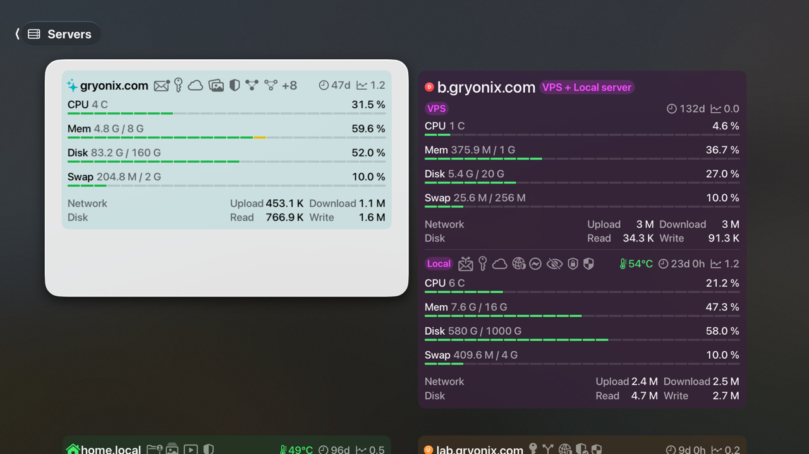
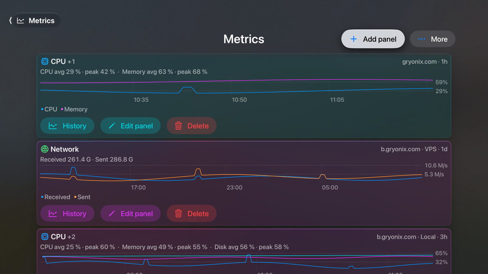

# What the app does

gryonixNexus sets up self-hosted services on your own servers and keeps
managing them. This page lists what it can do, by area. For how a server is
reached, see [SCENARIOS.md](SCENARIOS.md); for the VPN, see [VPN.md](VPN.md).

## Platforms

| Device | What you get |
|---|---|
| **iPhone** | The whole app. On iPhone Duo the server list and the open page sit side by side. Widgets, Live Activities and the Dynamic Island. |
| **iPad** | The whole app, in columns. |
| **Mac** | The whole app as a signed disk image, plus the VPN in the menu bar, start at login and a choice of Dock icon or menu bar only. |
| **Apple TV** | Servers, VPN, metrics and containers in the system sidebar, run with the remote. Nothing is typed on the TV. |
| **Android** | In development, not released. |

iPhone and iPad need iOS or iPadOS 17 or later, the Mac needs macOS 14, Apple
TV needs tvOS 18. The interface is in English and 27 other languages.

## Setting up a server

- **Configurator.** Pick a [scenario](SCENARIOS.md) and the services. The app
  generates the whole setup: Docker, the Caddy reverse proxy with HTTPS, the
  firewall and the DNS records. The setup is plain shell scripts you can read
  before they run.
- **DNS.** With a token for Cloudflare, DigitalOcean, GoDaddy, Google Cloud DNS,
  Hetzner, OVH, Porkbun or Route 53 the app creates the records itself.
  Otherwise it shows them.
- **Ports.** The app opens the server's own firewall and lists the ports to
  open in your provider's firewall or on your router.
- **The agent.** Each server runs a small agent, `gryonixnexusd`, that keeps the
  server's state and does the long jobs. It opens no port: the app reaches it
  through SSH. Its source is public at
  [github.com/gryonix/nexus-agent](https://github.com/gryonix/nexus-agent).

## Services

About 40 services:

| Group | Services |
|---|---|
| Mail | Mailcow, Mailu, Docker Mailserver. DKIM signing, MX, SPF, DKIM and DMARC records, a guided domain setup. |
| VPN | WireGuard, AmneziaWG, Shadowsocks, VLESS with Reality, OpenVPN, and a panel for client profiles. See [VPN.md](VPN.md). |
| Files | Nextcloud, Seafile |
| Photos | Immich, PhotoPrism |
| Passwords | Vaultwarden, Passbolt, Psono |
| Media | Jellyfin, AirPlay speaker (Shairport Sync), AirPlay screen (UxPlay), audio hub (odio). These need a machine at home. |
| Smart home | Home Assistant, Mosquitto, Zigbee2MQTT. These need a machine on your home network. |
| Games | Minecraft Java and Bedrock, Crafty Controller |
| Code | Forgejo, GitLab |
| Automation | n8n |
| AI | Ollama, Open WebUI, LiteLLM, AnythingLLM, Qdrant, SearXNG, OpenClaw |
| Network and DNS | AdGuard Home, Pi-hole |
| Remote access and mesh | Tailscale, Headscale, Cloudflare Tunnel |
| Single sign-on | Authelia |
| Dashboard | Homepage |

## Every day

- **Server cards.** CPU, memory, swap, disk and traffic of every machine, live.
  Cards can be resized, coloured and reordered.
- **Metrics.** History for every machine, and panels you pin to a board.
- **Containers.** Every container on a server, with start, stop, restart and logs.
- **Terminal.** An SSH terminal with keepalive and automatic reconnect. To reach
  a machine at home it tries its local address, the way through the VPS and its
  tunnel address in turn. A saved connection can go through a chosen server.
- **Wake on LAN** for a machine at home whose network card supports it.

## Keeping services safe and current

- **Backups.** Per service, on a schedule, optionally encrypted. Copies go to
  USB drives plugged into the server and to your other servers. A failed copy
  is a warning, never a failed backup. Restore from the app.
- **Updates.** Services and the operating system, on a schedule or by hand. If
  a new image does not start, the update is rolled back. The agent updates
  itself from a signed release.
- **Repair.** Re-runs the saved setup and puts back the firewall, the sites,
  permissions and stopped containers. Services and data are kept.
- **Moving a service** to another machine of the same server. Its data is
  copied; the old copy stays, stopped.
- **Removal.** Removes containers and configuration. Data and backups stay.

## Alerts

The server watches itself and tells you when something goes wrong:

- a service that stopped or keeps restarting, with the line from its log that
  says why;
- RAID and SMART problems, a disk filling up, a backup drive that went
  read-only or has had no new copy for days;
- a failed backup;
- an SSH sign-in;
- a new agent version.

Tapping an alert opens its server: alerts about services and backups on Apps,
the others on General. Some alerts carry a button: **Restart** for a service,
**Block address** for an SSH sign-in. Alerts arrive through the optional
gryonixPush relay or through your own ntfy topic.

A long job (an update, a backup, an install) shows a card in the Dynamic Island
and on the Lock Screen, and the server keeps it current while the app is
closed.

## Security

- No account and no cloud backend for your data. Passwords and keys stay in the
  device's Keychain.
- The admin pages of services can be limited to the VPN. Password login over
  SSH can be closed once keys are in place. CrowdSec can be installed.
- The app's own lock: Face ID, Touch ID or a passcode.
- See [SECURITY.md](../SECURITY.md) for the threat model.

## Your devices together

- **iCloud sync.** Servers, their SSH and VPN keys and imported VPN
  configurations reach your other iPhone, iPad, Mac and Apple TV through iCloud
  Keychain, encrypted end to end. Choose Apple's encryption, Apple's encryption
  plus your own password, or the server list only, without keys. Removing a
  server on one device does not remove it from the others.
- **Moving to another device.** A server can be handed over by QR code or as a
  `.gryonixserver` file. That file carries the server's SSH key, so treat it as
  the key itself.
- **Removing a server** can also take the app's access off the server: its SSH
  key and this device's VPN connections. If the key is the only way in, the app
  asks first.

## Apple TV

  
  

- Tabs: Servers, VPN, Metrics, Containers and Settings. You can reorder them,
  hide them and choose icons or text.
- Everything a server page offers that needs no typing: sites, connection
  settings, routes, the relay, services with backups and updates, metrics,
  containers and the agent. The system can be updated with one button. Disks are
  shown, not changed.
- Servers arrive through iCloud or are sent from a paired iPhone. A server can
  be removed from the TV only.
- The license is confirmed by a paired iPhone whenever Nexus is open on it
  nearby. Without it the TV stays unlocked for 10 days, or 20 with a lifetime
  license.

## License

Without a license the app runs built-in demo servers. Managing your own servers
needs a monthly, yearly or lifetime license, bought through the App Store or on
the website. The code is source-available, not open source: see
[LICENSE](../LICENSE).
