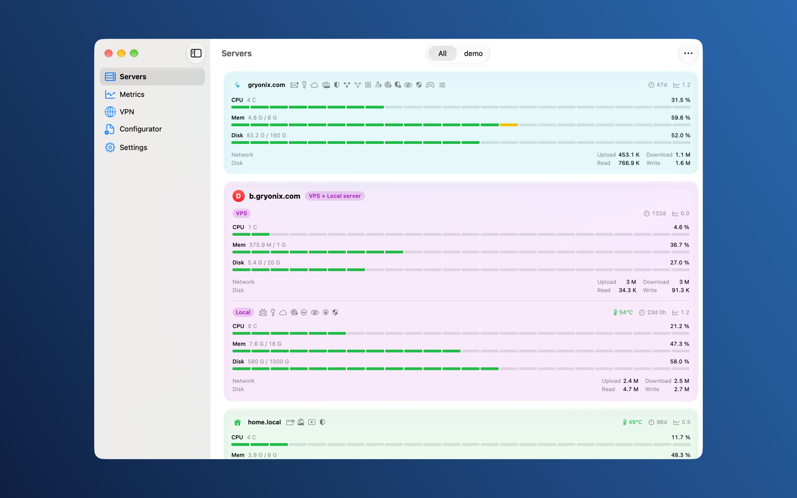
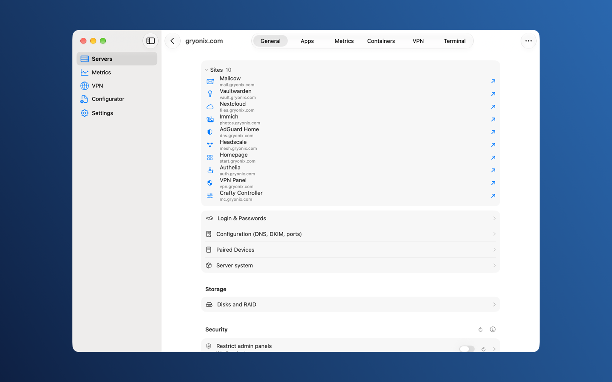
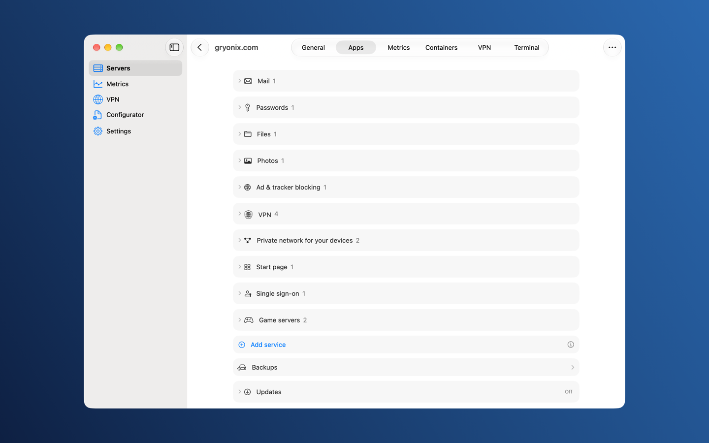
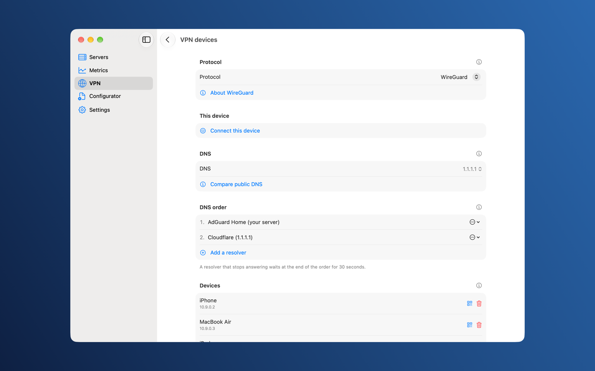
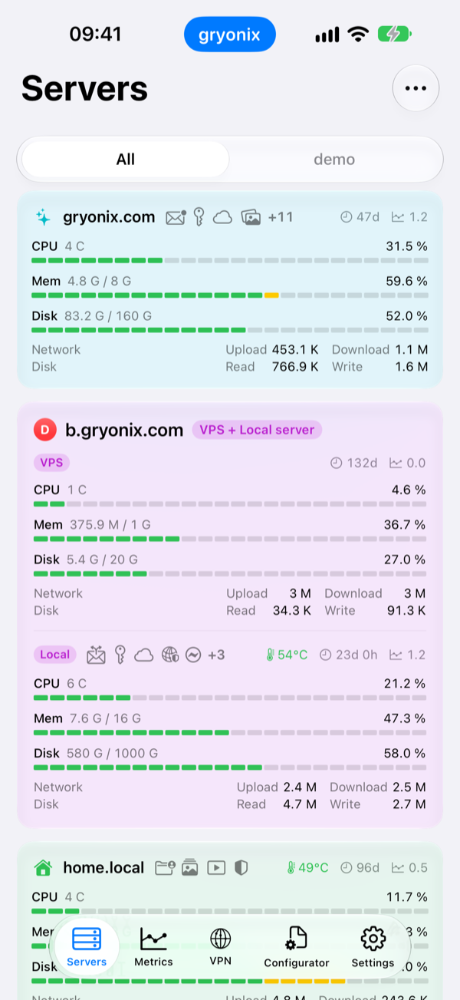
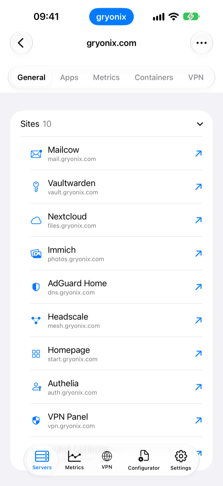
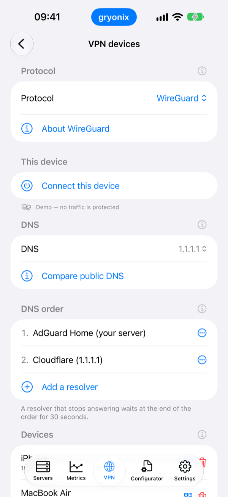

# gryonixNexus

**Run your own services on your own servers, without a cloud in between.**

gryonixNexus is an app for iPhone, iPad and Mac. It sets up and manages
self-hosted services on servers you control: mail, VPN, file storage,
photos, passwords, smart home and more. There is no backend and no account
system. The app talks to your servers over SSH and to nothing else.

  
  
  
  

  
  
  

## What it can run

Each service is installed and managed on the server from the app. The catalog
covers, among others:

- **Mail** with DKIM signing, DNS record generation and a guided domain setup.
- **VPN**: WireGuard, AmneziaWG, Shadowsocks, VLESS Reality and OpenVPN, with a
  control panel for peers.
- **Files, photos and passwords**: Nextcloud, Seafile, Immich, Vaultwarden and others.
- **Smart home and automation**: Home Assistant, Mosquitto, Zigbee2MQTT, n8n.
- **Networking**: DNS filtering, reverse proxy, Tailscale and Headscale.

A server can be a single public machine, or a public VPS that relays traffic
to a home machine over a WireGuard tunnel.

Beyond installing, the app runs backups and restores, shows metrics history,
and handles updates, repair and uninstall, all over SSH.

## How it works

- The **app** connects to a server over SSH and sends it scripts and commands.
- A small **agent**, `gryonixnexusd`, runs on each managed server. It keeps the
  server's state, does the work and answers the app through a local socket.
  The agent opens no port of its own. Its source is published separately at
  [github.com/gryonix/nexus-agent](https://github.com/gryonix/nexus-agent).
- Generated setup scripts are plain shell. You can read every line before it runs.
- Passwords and keys stay in the device's Keychain.

## Get it

- **Mac**: the signed disk image from [gryonix.com/nexus](https://gryonix.com/nexus/).
- **iPhone and iPad**: the App Store.
- **Android**: the code is in this repository, but no Android build is released yet.

## License

gryonixNexus is **source-available, not open source**. You can read the code,
fork it on GitHub and quote short excerpts. Building, running or distributing
it needs a license, with one exception: you may build and run it privately to
prepare a change for this repository. Official builds are governed by the
terms they are distributed under. Earlier versions remain under the license
they were published with.

Full terms: [LICENSE](LICENSE). Third-party components and their licenses:
[THIRD-PARTY.md](THIRD-PARTY.md).

## Repository layout

| Folder | Contents |
|---|---|
| `Apple/` | The iOS, iPadOS and macOS app: one Xcode project. `App/` holds SwiftUI screens and services, `Packages/gryonixNexus/` the Swift packages with the generation, catalog and SSH logic, `TunnelExtension/` the VPN packet tunnel, `Widgets/` the widgets and Live Activities, `AppTests/` and `TunnelExtensionTests/` the unit tests. |
| `Android/` | The Android app in Kotlin and Jetpack Compose. One Gradle module per shared area: `core`, `catalog`, `recipe`, `vpnprofile`, `servercontrol`, `agentclient`, `agentcontrol`, `transport`, plus `app` for the UI. `xraybridge/` is the Go bridge to Xray. |
| `Server/` | `gryonixnexusd/`, the Rust agent (sources, tests); `bootstrap/`, the install script and helpers the app sends to a server; `systemd/`, the unit files. |
| `Proto/` | `gryonixnexusd/v1/gryonixnexusd.proto`, the RPC schema shared by the agent, the Swift app and the Kotlin app. |
| `Go/` | Go parts of the tunnel runtime: `ss2022/` (Shadowsocks 2022 client with tests) and `apple-bridge/` (bindings for the Apple app). |
| `Tools/` | the xray-core change script; the rest on request (see its README) |

Root files: [LICENSE](LICENSE), [NOTICE](NOTICE), [THIRD-PARTY.md](THIRD-PARTY.md),
[CONTRIBUTING.md](CONTRIBUTING.md) (contribution terms and the Contributor
License Agreement), [SECURITY.md](SECURITY.md) (how to report a vulnerability).

## Contributing and security

Read [CONTRIBUTING.md](CONTRIBUTING.md) before opening a pull request. To report
a vulnerability, follow [SECURITY.md](SECURITY.md) and do not open a public issue.
