# gryonixNexus

**Run your own services on your own servers, without a cloud in between.**

gryonixNexus is an app for iPhone, iPad, Mac and Apple TV. It sets up and manages
self-hosted services on servers you control: mail, VPN, file storage,
photos, passwords, smart home and more. There is no account system and no
cloud between you and your servers: the app manages them over SSH. Everything
else it contacts is listed under [What the app connects to](#what-the-app-connects-to).

  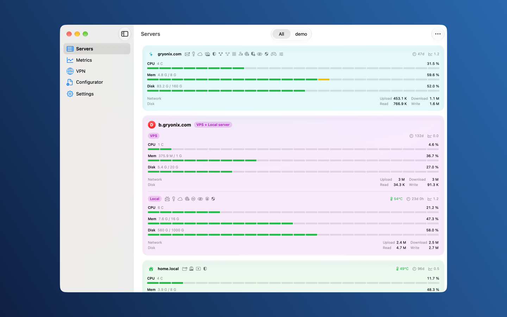
  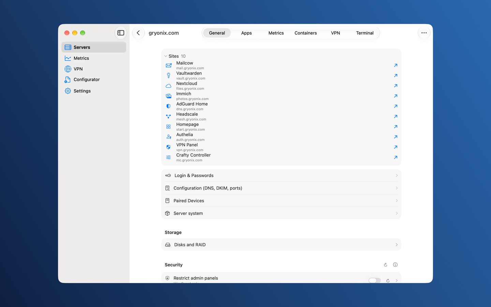
  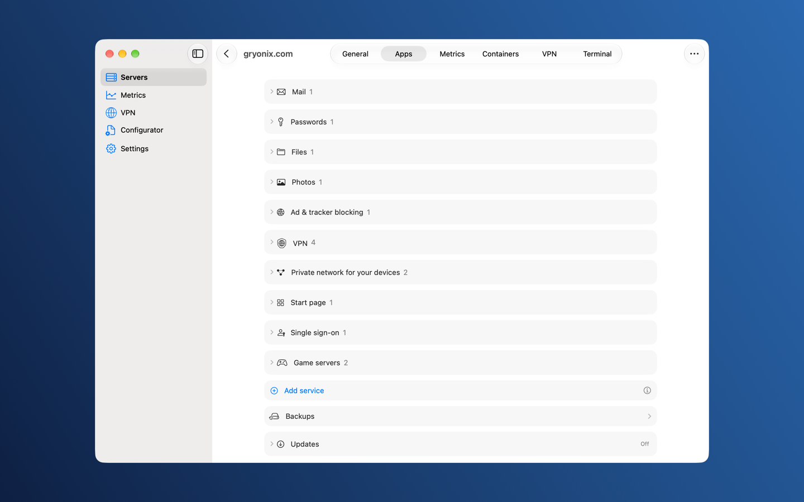
  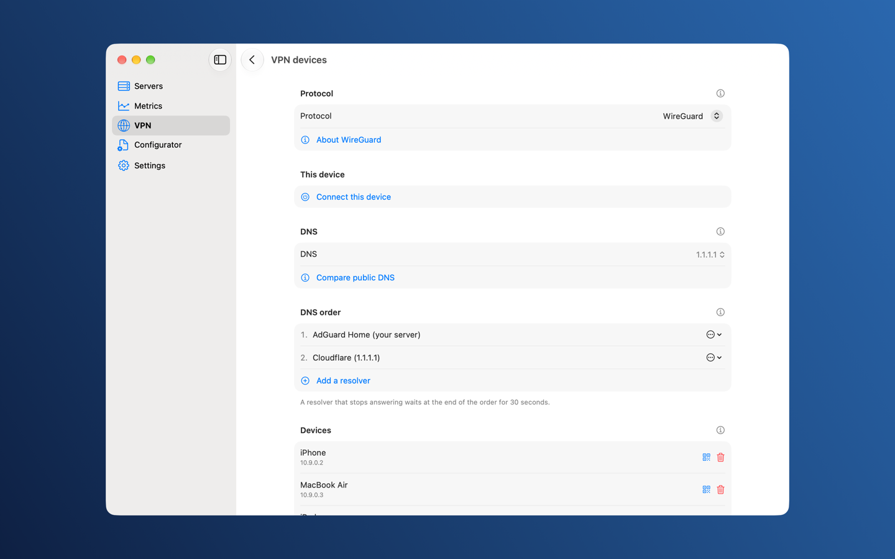

  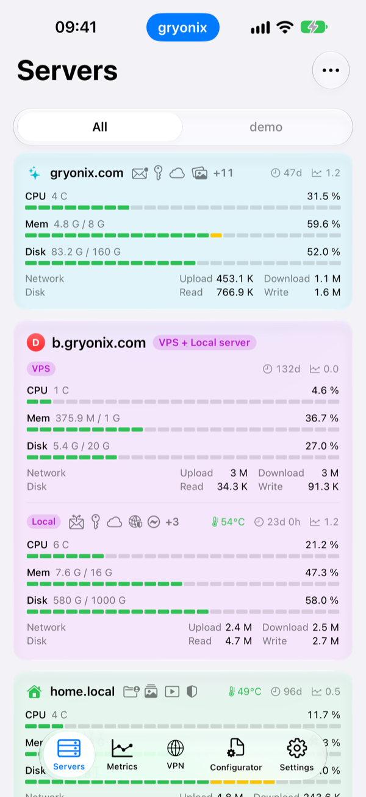
  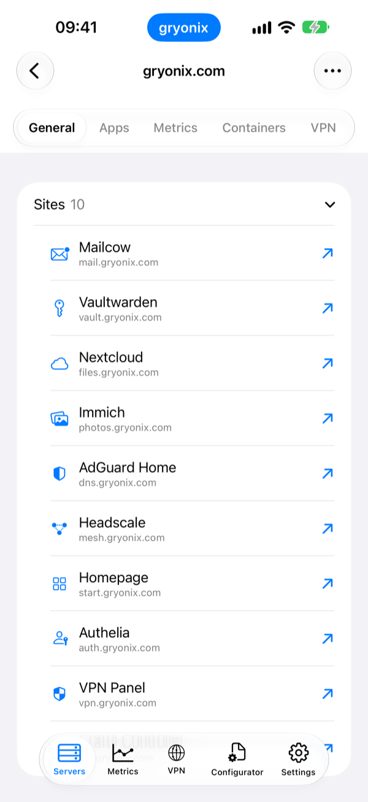
  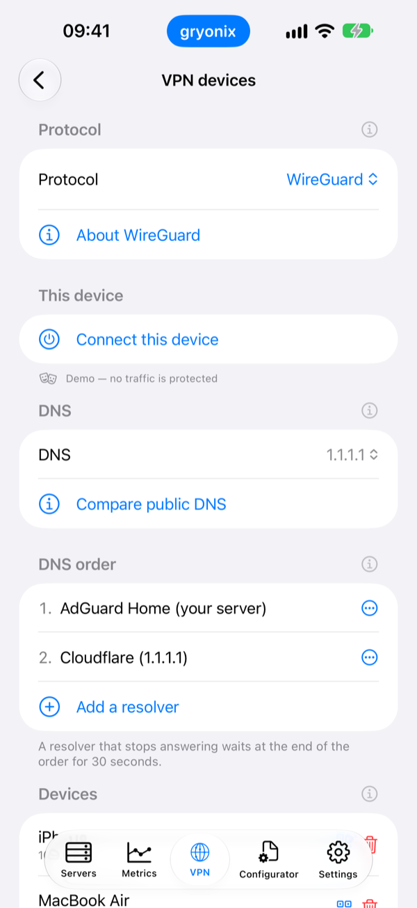

  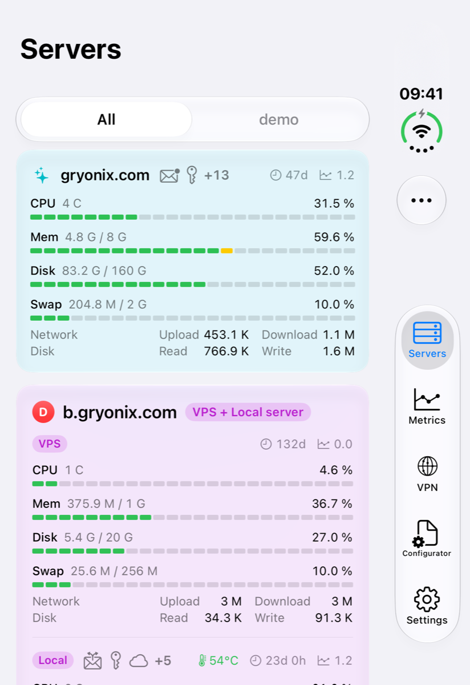
  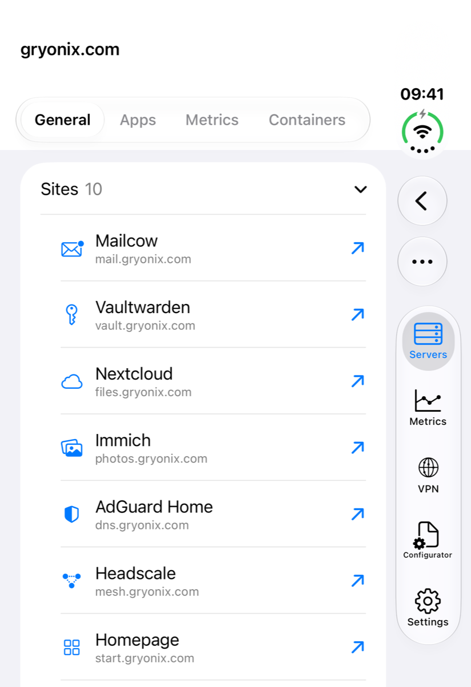
  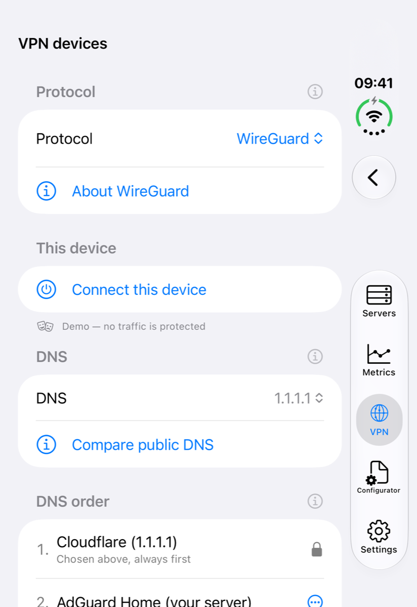

  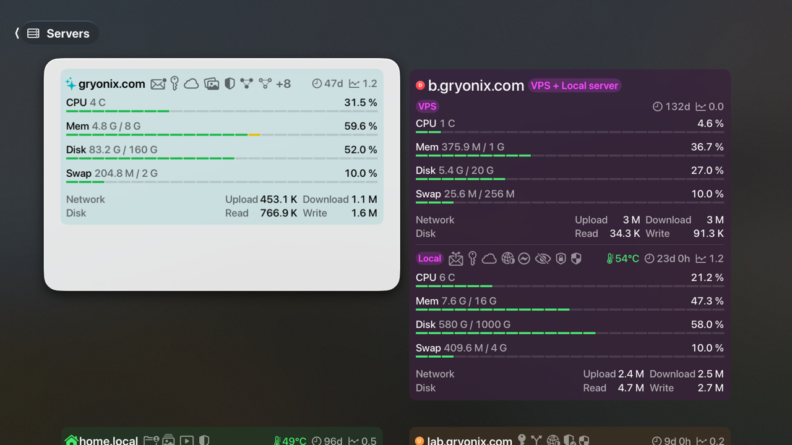
  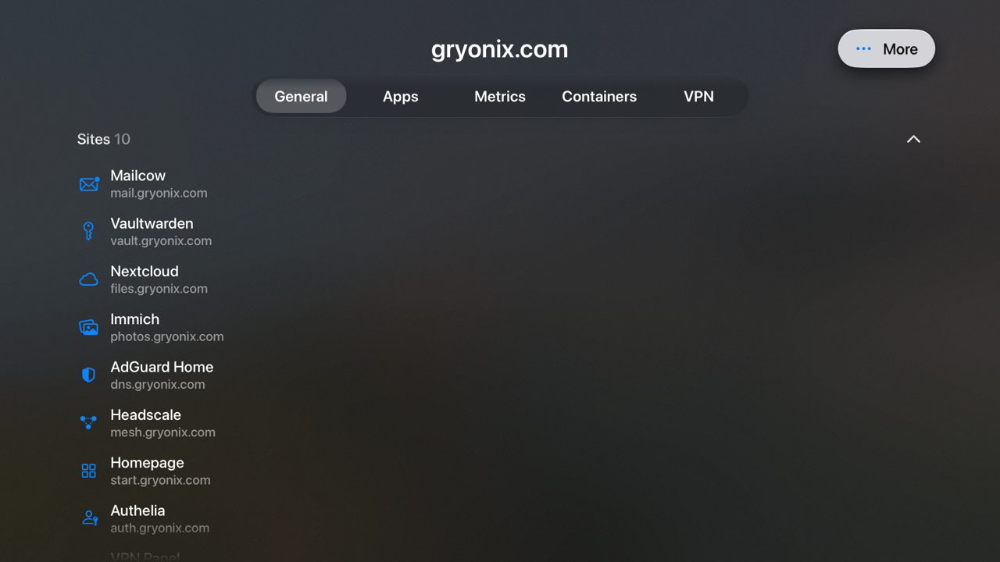
  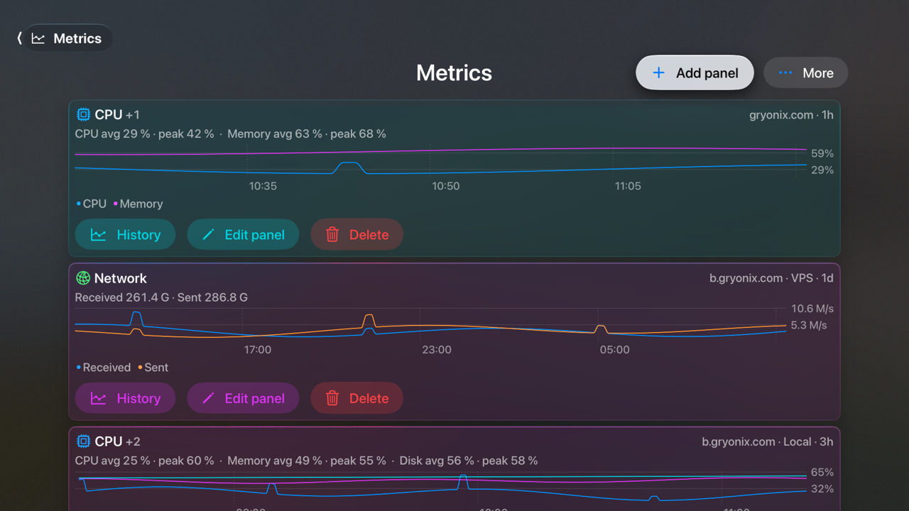

## What it can run

About 40 services, each installed and managed from the app:

- **Mail**: Mailcow, Mailu, Docker Mailserver, with DKIM signing, DNS records
  and a guided domain setup.
- **VPN**: WireGuard, AmneziaWG, Shadowsocks, VLESS with Reality and OpenVPN,
  with a panel for client profiles. The app itself is the VPN client too.
  [How the protocols compare and which to pick](Docs/VPN.md).
- **Files, photos and passwords**: Nextcloud, Seafile, Immich, PhotoPrism,
  Vaultwarden, Passbolt, Psono.
- **Smart home and automation**: Home Assistant, Mosquitto, Zigbee2MQTT, n8n.
- **AI**: Ollama, Open WebUI, LiteLLM, AnythingLLM, Qdrant, SearXNG, OpenClaw.
- **Networking and access**: AdGuard Home, Pi-hole, Headscale, Tailscale,
  Cloudflare Tunnel, Authelia.
- **Also**: Jellyfin, AirPlay speaker, AirPlay screen, audio hub, Forgejo, GitLab, Minecraft, Homepage.

Beyond installing, the app runs [backups and restores, updates with
rollback](Docs/FEATURES.md#keeping-services-safe-and-current), metrics history,
[alerts](Docs/FEATURES.md#alerts), a terminal, repair, moving a service and
removal, and keeps [your devices in step through iCloud](Docs/FEATURES.md#your-devices-together).
On [Apple TV](Docs/FEATURES.md#apple-tv) it runs with the remote alone.
Everything it does is in the [feature list](Docs/FEATURES.md).

## Where your server lives

Seven [network scenarios](Docs/SCENARIOS.md) cover a VPS, a machine at home,
both together, and setups that are never reachable from the internet at all.
Not sure which one fits? [Answer four questions](Docs/SCENARIOS.md#how-to-choose).

| Scenario | Machines | Needs | Mail and VPN |
|---|---|---|---|
| **Public IP** | One server with a public IP | A domain | Yes |
| **Public IP (VPS) + Local server** | A VPS in front of a machine at home | A domain; ports on the VPS only | Yes |
| **Home server with a changing address** | A machine at home | A domain, a public IPv4, ports on the router | Yes |
| **Server without open ports** | One machine, anywhere | A domain at Cloudflare | No, web only |
| **Only my own devices (Tailscale)** | One machine | A Tailscale account | No |
| **Only my own devices** | One machine, with its own Headscale | Nothing | No |
| **Local Server** | A machine at home | Nothing | No |

**Tip:** with a VPS in front of a home machine, [run the VPN on the
VPS](Docs/VPN.md#where-the-vpn-runs-with-a-vps-and-a-local-server), not at
home. Internet traffic then leaves straight from the VPS instead of crossing
your home connection twice. The app moves the VPN with all its devices in one
step. More on [making the VPN fast](Docs/VPN.md#speed).

## How it works

- The **app** connects to a server over SSH and sends it scripts and commands.
- A small **agent**, `gryonixnexusd`, runs on each managed server. It keeps the
  server's state, does the long jobs and answers the app through a local
  socket. The agent opens no port of its own. Its source is published
  separately at [github.com/gryonix/nexus-agent](https://github.com/gryonix/nexus-agent).
- Services run in Docker behind a Caddy reverse proxy with HTTPS.
- Generated setup scripts are plain shell. You can read every line before it runs.
- Passwords and keys stay in the device's Keychain. With iCloud sync they reach
  your other devices through iCloud Keychain, encrypted end to end.
- What the agent and the VPN panel may and may not do on the server, and the
  rest of the threat model, is in [SECURITY.md](SECURITY.md).

## What the app connects to

- **Your servers**, over SSH. Everything the app does to a server goes this way.
- **gryonix.com**: the license server, when you activate a code bought on the
  website and when the app checks that license; the update feed of the Mac build.
- **push.gryonix.com**: the notification relay, only for servers where you
  turned notifications on. It receives the device's push token and the events
  that server sends. You can name your own relay instead.
- **GitHub**: the agent's sources and its version from
  [gryonix/nexus-agent](https://github.com/gryonix/nexus-agent) when a server
  installs or updates the agent, and the country address list for VPN rules by
  country.
- **Your DNS provider's API** (Cloudflare, Route 53, Google Cloud DNS, Hetzner,
  OVH, Porkbun, GoDaddy, DigitalOcean), only with a token you enter, to create
  and check DNS records.
- **Apple**: the App Store for purchases, iCloud if you turn sync on, and push
  delivery. On Android, push delivery goes through Firebase Cloud Messaging.
- **Only if you turn them on**: the AI provider you choose, with your own key;
  subscription and blocklist addresses you add to the VPN.

## Get it

- **Mac**: the signed disk image from [gryonix.com/nexus](https://gryonix.com/nexus/).
- **iPhone, iPad and Apple TV**: the App Store.
- **Android**: the code is in this repository, but no Android build is released yet.

## Support

- **Community and help**: [Discord](https://discord.gg/RsMMRPgzhK).
- **E-mail**: [support@gryonix.com](mailto:support@gryonix.com).
- **Security reports**: see [SECURITY.md](SECURITY.md).

## License

gryonixNexus is **source-available, not open source**. You can read the code,
download it to read it, review its security or report a problem, and quote
short excerpts. Building, running, copying, forking or distributing it needs
the Licensor's written consent by e-mail, for personal, commercial and
charitable use alike. The code may be changed only to send that change to the
Licensor for review, and for nothing else. Official builds are governed by the
terms they are distributed under. The license may change at any time. Earlier
versions remain under the license they were published with.

Full terms: [LICENSE](LICENSE). Third-party components and their licenses:
[THIRD-PARTY.md](THIRD-PARTY.md).

## Repository layout

| Folder | Contents |
|---|---|
| `Apple/` | The iOS, iPadOS, macOS and tvOS app: one Xcode project. `App/` holds SwiftUI screens and services, `TV/` the Apple TV screens, `Packages/gryonixNexus/` the Swift packages with the generation, catalog and SSH logic, `TunnelExtension/` the VPN packet tunnel, `Widgets/` the widgets and Live Activities, `AppTests/` and `TunnelExtensionTests/` the unit tests. |
| `Android/` | The Android app in Kotlin and Jetpack Compose. One Gradle module per shared area: `core`, `catalog`, `recipe`, `vpnprofile`, `servercontrol`, `agentclient`, `agentcontrol`, `transport`, plus `app` for the UI. `xraybridge/` is the Go bridge to Xray. |
| `Server/` | `gryonixnexusd/`, the Rust agent (sources, tests); `bootstrap/`, the install script and helpers the app sends to a server; `systemd/`, the unit files. |
| `Proto/` | `gryonixnexusd/v1/gryonixnexusd.proto`, the RPC schema shared by the agent, the Swift app and the Kotlin app. |
| `Go/` | Go parts of the tunnel runtime: `ss2022/` (Shadowsocks 2022 client with tests) and `apple-bridge/` (bindings for the Apple app). |
| `Tools/` | the xray-core change script; the rest on request (see its README) |
| `Docs/` | How the app works for people who use it: [scenarios](Docs/SCENARIOS.md), [VPN](Docs/VPN.md), [features](Docs/FEATURES.md). |

Root files: [LICENSE](LICENSE), [NOTICE](NOTICE), [THIRD-PARTY.md](THIRD-PARTY.md),
[CONTRIBUTING.md](CONTRIBUTING.md) (contribution terms and the Contributor
License Agreement), [SECURITY.md](SECURITY.md) (how to report a vulnerability).

## Contributing and security

Read [CONTRIBUTING.md](CONTRIBUTING.md) before opening a pull request. To report
a vulnerability, follow [SECURITY.md](SECURITY.md) and do not open a public issue.
